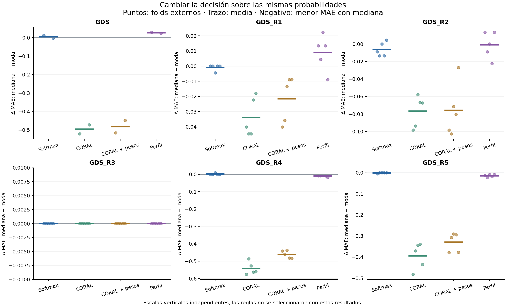
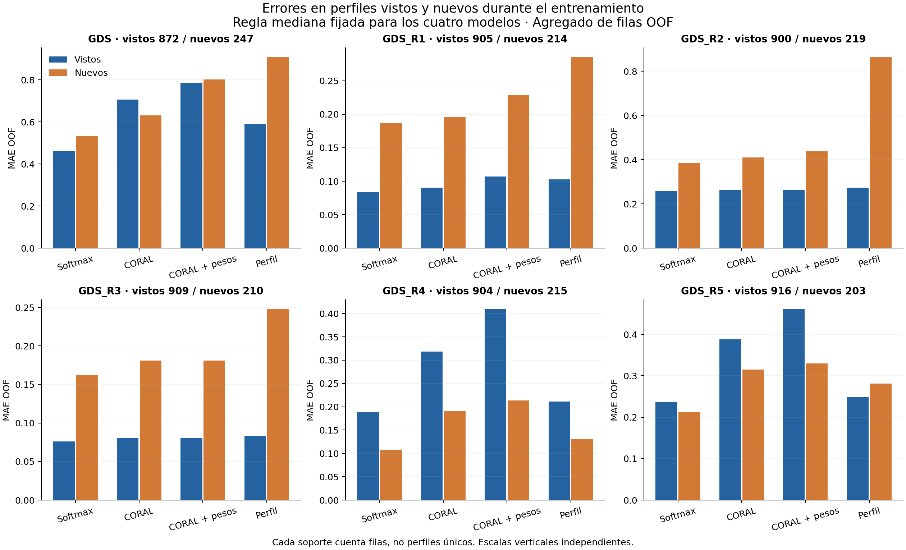

# Decisiones y perfiles de respuesta

Se reutilizan probabilidades externas de Softmax, CORAL, CORAL ponderada y el predictor por perfil, sin entrenar redes. Las reglas se comparan sobre las mismas filas, probabilidades y folds. La selección interna de las redes se hizo con su decisión original; no se volvió a optimizar para cada regla.

## Cambios de decisión

Diferencia = mediana − moda. Las medias y desviaciones (ddof=0) corresponden a folds externos; no son intervalos de confianza. Los cambios cuentan filas OOF. Las cifras no seleccionan una regla ganadora para futuros datos.

| Objetivo | Modelo | Δ MAE externo | Δ errores graves externo | Cambios OOF |
|---|---|---:|---:|---:|
| GDS | Softmax | 0.0045 ± 0.0080 | 0.0027 | 35 |
| GDS | CORAL | -0.4969 ± 0.0246 | -0.2091 | 579 |
| GDS | CORAL + pesos | -0.4825 ± 0.0335 | -0.2252 | 465 |
| GDS | Perfil | 0.0259 ± 0.0027 | 0.0080 | 278 |
| GDS_R1 | Softmax | -0.0009 ± 0.0018 | 0.0000 | 1 |
| GDS_R1 | CORAL | -0.0339 ± 0.0115 | -0.0018 | 56 |
| GDS_R1 | CORAL + pesos | -0.0214 ± 0.0137 | -0.0054 | 46 |
| GDS_R1 | Perfil | 0.0089 ± 0.0106 | 0.0000 | 26 |
| GDS_R2 | Softmax | -0.0062 ± 0.0073 | -0.0009 | 33 |
| GDS_R2 | CORAL | -0.0768 ± 0.0160 | -0.0259 | 178 |
| GDS_R2 | CORAL + pesos | -0.0759 ± 0.0270 | -0.0295 | 181 |
| GDS_R2 | Perfil | -0.0009 ± 0.0137 | -0.0063 | 81 |
| GDS_R3 | Softmax | 0.0000 ± 0.0000 | 0.0000 | 0 |
| GDS_R3 | CORAL | 0.0000 ± 0.0000 | 0.0000 | 0 |
| GDS_R3 | CORAL + pesos | 0.0000 ± 0.0000 | 0.0000 | 0 |
| GDS_R3 | Perfil | 0.0000 ± 0.0000 | 0.0000 | 0 |
| GDS_R4 | Softmax | 0.0018 ± 0.0036 | 0.0000 | 2 |
| GDS_R4 | CORAL | -0.5425 ± 0.0323 | -0.0134 | 743 |
| GDS_R4 | CORAL + pesos | -0.4611 ± 0.0195 | -0.0116 | 610 |
| GDS_R4 | Perfil | -0.0098 ± 0.0044 | 0.0000 | 13 |
| GDS_R5 | Softmax | -0.0009 ± 0.0018 | 0.0000 | 1 |
| GDS_R5 | CORAL | -0.3941 ± 0.0557 | -0.0232 | 625 |
| GDS_R5 | CORAL + pesos | -0.3298 ± 0.0399 | -0.0206 | 489 |
| GDS_R5 | Perfil | -0.0143 ± 0.0052 | 0.0000 | 46 |

Los archivos pareados también incluyen mediana−original y moda−original para las redes. El error firmado se define como predicción−verdad: valores negativos indican subestimación. Las tablas conservan las tasas de subestimación, sobreestimación y errores graves por dirección.

En R2, Softmax pasa de MAE OOF 0.2895 con moda a 0.2833 con mediana. La subestimación pasa de 18.1% a 17.3%, y la sobreestimación de 9.2% a 9.5%.

## Perfiles vistos y nuevos

Se usa la mediana como regla común prefijada para describir el MAE, sin elegirla por el test. Visto significa que las 15 respuestas aparecieron en el entrenamiento del fold; no identifica una persona. Para un perfil nuevo, el predictor por perfil recurre a la distribución global suavizada del entrenamiento. Las tablas también incluyen moda y las decisiones originales, con soportes por clase.

Ejemplo en GDS_R2: valores agregados OOF, distintos del promedio de folds.

| Modelo | MAE vistos | MAE nuevos | Graves vistos | Graves nuevos |
|---|---:|---:|---:|---:|
| Softmax | 0.2589 | 0.3836 | 0.0133 | 0.0228 |
| CORAL | 0.2644 | 0.4110 | 0.0200 | 0.0502 |
| CORAL + pesos | 0.2633 | 0.4384 | 0.0189 | 0.0457 |
| Perfil | 0.2744 | 0.8630 | 0.0078 | 0.2603 |

### Recall por clase en GDS_R2, regla mediana

| Modelo | Grupo | Soportes (clases 1/2/3) | Recalls (clases 1/2/3) |
|---|---|---|---|
| Softmax | visto | 562 / 223 / 115 | 0.899 / 0.511 / 0.522 |
| Softmax | nuevo | 87 / 75 / 57 | 0.747 / 0.493 / 0.667 |
| CORAL | visto | 562 / 223 / 115 | 0.947 / 0.336 / 0.635 |
| CORAL | nuevo | 87 / 75 / 57 | 0.805 / 0.373 / 0.737 |
| CORAL + pesos | visto | 562 / 223 / 115 | 0.936 / 0.359 / 0.643 |
| CORAL + pesos | nuevo | 87 / 75 / 57 | 0.816 / 0.267 / 0.737 |
| Perfil | visto | 562 / 223 / 115 | 0.845 / 0.610 / 0.426 |
| Perfil | nuevo | 87 / 75 / 57 | 1.000 / 0.000 / 0.000 |

## Alcance

Cambiar moda por mediana modifica la decisión, no el aprendizaje. Comparar el predictor por perfil con una red sí cambia el estimador y el aprendizaje; sus diferencias no se atribuyen solo a la regla. Los grupos visto/nuevo tienen distinta composición y soporte: una diferencia de errores no demuestra por sí sola un efecto causal de novedad.

Los perfiles con etiquetas contradictorias describen ambigüedad empírica del archivo completo; no estiman el límite poblacional ni una cota que deba respetar el conjunto de modelos OOF. Los seis objetivos usan los mismos registros y los entrenamientos de los folds se solapan. No se aplican pruebas que traten folds u objetivos como muestras independientes. Los recalls sin soporte se dejan como no estimables, no como ceros.

La interpretación de estos resultados está en [el informe](../../../docs/informe.md#resultados-de-decisiones-y-perfiles).
